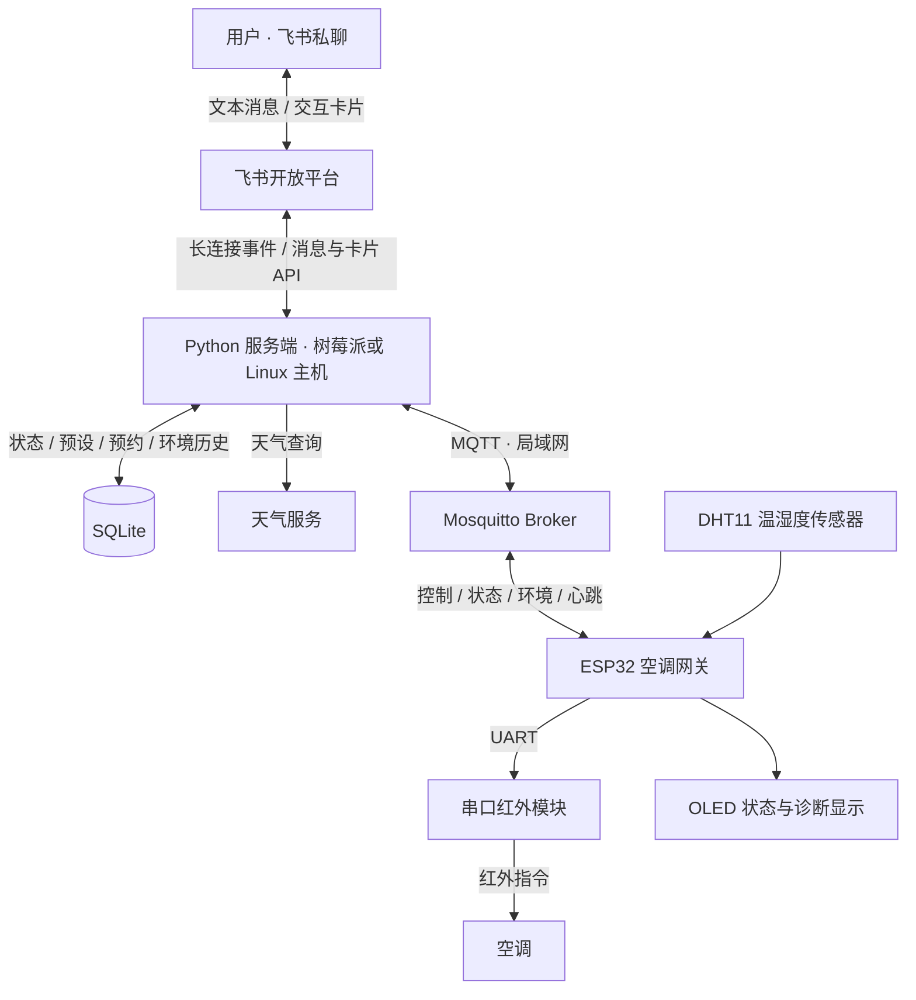

# AirConditionRemote

通过飞书远程控制家中的红外空调，并查看室内温湿度、使用常用预设和预约、获取天气建议，以及运行夜间温控。

项目由 **Python 服务端**和 **ESP32 空调网关**组成：服务端把飞书消息与卡片操作转换成控制指令，网关通过串口红外模块控制空调，并将环境读数和网关状态回传。飞书采用长连接接收事件，无需为服务端开放公网回调端口。

本仓库是项目的总览与导航入口。源码、安装步骤、开发指南和维护记录分别位于以下两个子仓库：

| 仓库 | 负责什么 | 主要技术 |
| --- | --- | --- |
| [AirConditionRemoteServer](https://github.com/miaotenone/AirConditionRemoteServer) | 飞书交互、指令解析、预设与预约、天气建议、环境历史、夜间控制和本地持久化 | Python 3.10+、lark-oapi、paho-mqtt、SQLite、uv |
| [AirConditionRemoteCTL](https://github.com/miaotenone/AirConditionRemoteCTL) | 配网、MQTT 通信、红外控制、温湿度采集、OLED 显示与设备侧失联保护 | ESP32、Arduino、C++、PlatformIO |

## 整体架构



典型部署将 Python 服务与 Mosquitto 放在同一台树莓派或 Linux 主机上，ESP32 通过 2.4GHz WiFi 接入局域网。用户可以在外网通过飞书操作；服务端需要访问飞书开放平台，网关与 broker 之间保持局域网通信。

一次控制的路径是：**飞书操作 → 服务端解析 → MQTT 指令 → ESP32 → 红外模块 → 空调**。网关随后回传影子状态，服务端据此更新卡片；DHT11 读数则用于室内环境展示、历史图表和夜间控制。

## 可以做什么

| 能力 | 使用方式与行为 |
| --- | --- |
| 遥控卡片 | 在飞书中操作电源、模式、设定温度和风速，查看网关状态 |
| 中文短句控制 | 发送 `开机`、`制冷26度`、`调低两度` 等指令，或用 `状态`、`帮助` 查询 |
| 常用预设与单次预约 | 保存常用空调设置，立即执行或安排一次定时操作 |
| 天气建议 | 查询天气并获得空调使用建议，由用户确认后执行 |
| 室内环境与历史 | 查看 DHT11 温湿度读数，按时间窗口查询历史图表 |
| 夜间温控 | 服务端根据有效室温读数、夜间时间段与目标温度进行闭环决策 |
| 设备显示与诊断 | OLED 展示空调影子状态、室内环境、连接与固件信息；可选三键用于导航和只读诊断 |
| 失联保护与恢复 | 设备检测网络和服务心跳，满足条件时发送一次红外关机；恢复后由服务端按事件与既有策略尝试恢复 |

当前服务面向**单个 owner 的飞书私聊和单台空调**。中文控制使用规则解析器，支持范围见服务端帮助与文档。

## 需要准备什么

| 部分 | 所需内容 |
| --- | --- |
| 空调与红外 | 可由所用串口红外模块支持的空调、匹配的品牌配置；接入前确认协议与实际控制效果 |
| 设备端 | ESP32-WROOM-32E、串口红外模块（115200 8N1）、DHT11、1.3 英寸 SH1106 OLED、供电与连接线；三键导航可选 |
| 网络 | 2.4GHz WiFi，以及 ESP32 和服务端均可连接的 MQTT broker |
| 服务主机 | 树莓派或其他 Linux 主机，用于常驻运行 Python 服务和 Mosquitto；本地开发也支持 Windows |
| 飞书 | 自建应用、机器人及所需权限与事件配置，配置应用凭据和唯一 owner 的 `open_id` |
| 开发工具 | Git；固件侧使用 PlatformIO，服务端使用 Python 3.10+ 和 uv |

详细引脚、电源、共地和 DHT11 上拉要求见 [设备接线表](https://github.com/miaotenone/AirConditionRemoteCTL/blob/main/docs/wiring.md)。红外兼容范围与品牌码见 [串口协议](https://github.com/miaotenone/AirConditionRemoteCTL/blob/main/docs/protocol.md)。

## 从哪里开始

### 1. 获取两个子项目

```sh
git clone https://github.com/miaotenone/AirConditionRemoteCTL.git
git clone https://github.com/miaotenone/AirConditionRemoteServer.git
```

两个仓库分别开发、构建与运行。阅读本总览即可了解系统，搭建时进入对应仓库，按各自 README 操作。

### 2. 准备 broker 与飞书应用

按 [服务端部署指南](https://github.com/miaotenone/AirConditionRemoteServer/blob/main/docs/deployment.md) 配置 Mosquitto 的局域网访问、认证与 ACL，再按 [飞书设置指南](https://github.com/miaotenone/AirConditionRemoteServer/blob/main/docs/feishu-setup.md) 配置机器人和事件订阅。

服务端仓库中的 loopback 匿名 broker 配置只供本机开发，ESP32 无法从局域网连接该配置。连接真实设备时使用部署指南中的私网方案。

### 3. 接线、构建和配置网关

按 [固件 README](https://github.com/miaotenone/AirConditionRemoteCTL#readme) 与接线表准备硬件，使用 PlatformIO 构建和烧录。首次配网通过网关热点与网页填写 WiFi、MQTT 地址与认证、topic 前缀和空调品牌码，配置保存在设备 NVS 中。

完成后检查 OLED 的连接信息，并按照 [硬件联调指南](https://github.com/miaotenone/AirConditionRemoteCTL/blob/main/docs/hardware-validation.md) 确认温湿度采集与红外控制。

### 4. 配置并启动服务端

按 [服务端 README](https://github.com/miaotenone/AirConditionRemoteServer#readme) 使用 `uv sync --frozen` 安装锁定依赖，配置飞书凭据、owner 和 MQTT 参数。双端必须使用相同 broker 与 topic 前缀，默认前缀为 `ac`。

先在终端确认飞书与 MQTT 连接正常，再按部署指南配置 Linux 常驻服务。开发机只想查看卡片时，可在服务端仓库运行以下命令，无需填写凭据或启动实际控制服务：

```sh
uv sync --frozen
uv run --frozen python -m app.main --print-card
```

### 5. 在飞书中使用

向机器人发送 `设置卡片` 打开遥控卡片，发送 `状态` 查看网关状态，确认链路正常后尝试控制。发送 `预设`、`天气`、`夜间`、`历史` 进入相应功能，发送 `帮助` 查看支持的命令。

## 两端如何协作

两端以 MQTT 契约连接，自动控制决策放在服务端，传感器采集与红外执行放在设备端。默认 topic 前缀为 `ac`：

| Topic | 方向 | 内容 |
| --- | --- | --- |
| `ac/cmd` | 服务端 → 网关 | 电源、模式、温度、风速等控制字段 |
| `ac/hb` | 服务端 → 网关 | 服务心跳，用于区分 broker 在线和控制服务存活 |
| `ac/state` | 网关 → 服务端 | 网关记忆的空调影子状态 |
| `ac/status` | 网关 / broker → 服务端 | 网关上线信息与离线遗嘱 |
| `ac/env` | 网关 → 服务端 | 温度、湿度和读数是否有效 |
| `ac/event` | 网关 → 服务端 | 失联关机事件及关机前影子状态 |

`state/status/env` 为 retained 消息，`cmd/hb/event` 不 retained。服务端只将新的有效环境消息用于历史与控制，避免把 retained 旧读数当作新采样。字段、QoS、确认与恢复时序以 [MQTT 接口契约](https://github.com/miaotenone/AirConditionRemoteServer/blob/main/docs/interface-spec.md#4-mqtt-契约与固件仓库的唯一接口) 为准；改动协议时需要同步检查两个子项目。

## 使用边界

- **影子状态不等于空调实测状态。** 红外是单向发送，网关回执说明网关处理了指令，不能证明空调实际执行；使用实体遥控器改变空调后，网关不会自动获知。
- **环境控制依赖有效采样。** DHT11 精度有限，读取失败或数据过期时不能继续把旧值当作新的控制依据。“一天”历史窗口从本地当天 00:00 起算，少于两个样点不绘制曲线。
- **失联保护有启用条件和计时过程。** 设备先建立过健康的网络与服务心跳联系才武装保护。之后网络断开约 300 秒触发关机；仅服务心跳中断时，约为最后心跳后的 90 + 300 秒，另有循环延迟。配网阶段不运行主循环保护。
- **自动恢复是尽力而为。** 待报事件可能因设备重启丢失，恢复操作也可能与用户新命令交错。具体限制见 [设备运行时约定](https://github.com/miaotenone/AirConditionRemoteCTL/blob/main/docs/runtime.md) 与 [服务端时间与恢复边界](https://github.com/miaotenone/AirConditionRemoteServer/blob/main/docs/interface-spec.md#44-时间与恢复边界)。
- **按可信局域网部署。** 当前设备端 MQTT 未使用 TLS，默认 OTA 未设置密码；不要向公网暴露设备或 broker。配置方式见双端安全说明：[固件安全](https://github.com/miaotenone/AirConditionRemoteCTL/blob/main/SECURITY.md) / [服务端安全](https://github.com/miaotenone/AirConditionRemoteServer/blob/main/SECURITY.md)。

## 文档与贡献入口

| 想了解什么 | 从这里阅读 |
| --- | --- |
| 固件构建、测试与代码结构 | [固件开发指南](https://github.com/miaotenone/AirConditionRemoteCTL/blob/main/docs/development.md) |
| 接线、配网、设备行为与排障 | [固件 README](https://github.com/miaotenone/AirConditionRemoteCTL#readme) · [接线表](https://github.com/miaotenone/AirConditionRemoteCTL/blob/main/docs/wiring.md) · [运行时约定](https://github.com/miaotenone/AirConditionRemoteCTL/blob/main/docs/runtime.md) |
| 服务端安装、测试与代码结构 | [服务端开发指南](https://github.com/miaotenone/AirConditionRemoteServer/blob/main/docs/development.md) |
| 飞书应用与 Linux 常驻部署 | [飞书设置](https://github.com/miaotenone/AirConditionRemoteServer/blob/main/docs/feishu-setup.md) · [部署指南](https://github.com/miaotenone/AirConditionRemoteServer/blob/main/docs/deployment.md) |
| 跨端字段与通信行为 | [接口规格](https://github.com/miaotenone/AirConditionRemoteServer/blob/main/docs/interface-spec.md) |
| 参与开发与提交规范 | [固件贡献指南](https://github.com/miaotenone/AirConditionRemoteCTL/blob/main/CONTRIBUTING.md) · [服务端贡献指南](https://github.com/miaotenone/AirConditionRemoteServer/blob/main/CONTRIBUTING.md) |

功能问题和改动请提交到对应子仓库；涉及 MQTT 契约的修改需说明对另一端的影响。测试、构建和历史真机记录各有验证范围，实际部署仍需核对当前硬件与端到端链路。

## 许可证

本仓库采用 [Apache License 2.0](LICENSE)。两个子项目的授权及依赖信息请分别查看各自仓库中的 LICENSE 和相关声明。
